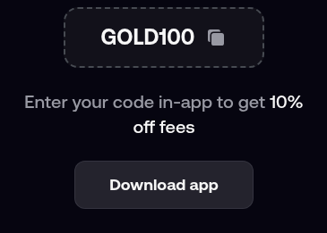

# FOMO app referral code: GOLD100 (as of November 2026)

**GOLD100 is the FOMO app referral code.** Type it into the code box while you create your FOMO account, and your trading fee drops by 10%, from 0.50% to 0.45%.

## Where does GOLD100 go in the FOMO app?

The app asks for a code during sign-up. That box is the only place it counts, so fill it in before you finish registering.

## How do I sign up with GOLD100?

1. Install FOMO and start creating an account.
2. When the code box appears, type `GOLD100` in capitals.
3. Make sure the app accepts it before moving on.
4. Finish the remaining verification steps.

## What does the code change?

Only the fee. Trades are charged 0.45% instead of the standard 0.50%. Nothing else about the app changes.

## What mistakes stop the code from working?

- Skipping the box and planning to add the code later.
- A stray space before or after the code.
- Typing GOLD10 or GOLD1OO (letter O instead of zero).

## Quick FAQ

**Is it called an invite code or a referral code?** People use both names. It is the same code in the same box.

**Is the discount guaranteed forever?** FOMO sets its own fees and can change them. The figure above is what applied as of November 2026.

---
*Disclosure: this is our referral code, and we may earn a reward when it is used. Crypto trading carries risk.*
